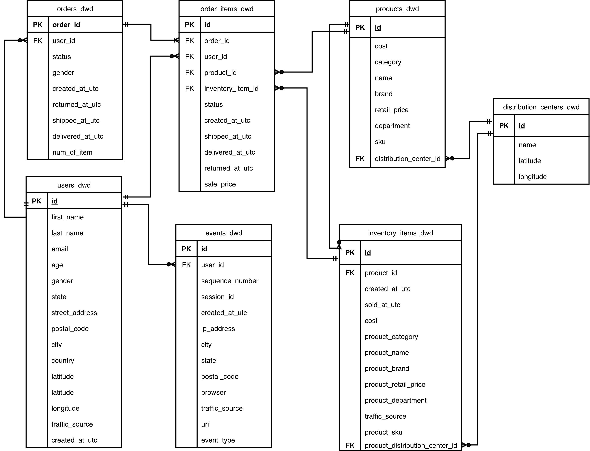

# Fact and Dimension Design / 事实表与维度表设计

## Modeling Principle / 建模原则

A fact table records a business process at a defined grain and contains measurable values and foreign keys. A dimension table provides the descriptive attributes used to filter, group, and explain those facts.  
事实表以明确粒度记录业务过程，包含度量值和外键；维度表提供用于筛选、分组和解释事实的描述属性。

## Source Table Classification / 源表分类

| Source table | Role / 角色 | Project handling / 项目处理方式 |
| --- | --- | --- |
| `users` | Dimension source / 维度来源 | Builds customer attributes such as demographics, geography, and acquisition source. / 构建用户画像、地理和获客来源属性。 |
| `products` | Dimension source / 维度来源 | Builds product, price, cost, brand, category, and distribution-center attributes. / 构建商品、价格、成本、品牌、品类和配送中心属性。 |
| `distribution_centers` | Dimension source / 维度来源 | Builds distribution-center location attributes. / 构建配送中心位置属性。 |
| `orders` | Fact source / 事实来源 | Builds the order-grain fact. / 构建订单粒度事实表。 |
| `order_items` | Core fact source / 核心事实来源 | Builds the order-item-grain sales fact. / 构建订单项粒度销售事实表。 |
| `inventory_items` | Source retained through DWD / 保留至 DWD 的源表 | Loaded and cleaned only; no fact, DWS, ADS, or downstream inventory analysis. / 仅加载和清洗，不建立事实表、DWS、ADS 或下游库存分析。 |
| `events` | Source retained through DWD / 保留至 DWD 的源表 | Loaded and cleaned only; no fact, DWS, ADS, or downstream event analysis. / 仅加载和清洗，不建立事实表、DWS、ADS 或下游事件分析。 |

## ER Diagram( based on the dwd level table)

## Core DW Tables / 核心 DW 表

| Table | Grain / 粒度 | Description / 说明 |
| --- | --- | --- |
| `dim_customers` | One row per customer / 每个用户一行 | Customer demographics, location, acquisition source, registration date, and first-order date. / 用户画像、地理、获客来源、注册日期和首次下单日期。 |
| `dim_products` | One row per product / 每个商品一行 | Product catalog, price, cost, SKU, category, brand, and distribution-center attributes. / 商品目录、价格、成本、SKU、品类、品牌和配送中心属性。 |
| `dim_date` | One row per date / 每个日期一行 | Calendar attributes for time-series analysis. / 用于时间序列分析的日期属性。 |
| `dim_order_status` | One row per order status / 每种订单状态一行 | Standardized order-status labels and groups. / 标准化订单状态标签和分组。 |
| `dim_distribution_centers` | One row per distribution center / 每个配送中心一行 | Distribution-center name and geographic attributes. / 配送中心名称和地理属性。 |
| `dim_traffic_sources` | One row per acquisition source / 每个获客来源一行 | Standardized customer acquisition-source labels. / 标准化用户获客来源标签。 |
| `fct_order_items` | One row per order item / 每个订单项一行 | Core sales fact with revenue, gross profit, status, return/cancel flags, and delivery measures. / 核心销售事实表，包含收入、毛利、状态、退货/取消标记和配送指标。 |
| `fct_orders` | One row per order / 每个订单一行 | Order-level fact for order counts, values, statuses, item counts, and fulfillment timing. / 订单级事实表，用于订单数、金额、状态、件数和履约时效分析。 |

## Star Schema Relationships / 星型模型关系

The primary star is `fct_order_items`. `fct_orders` shares the customer, date, and order-status dimensions at order grain.  
主星型模型以 `fct_order_items` 为中心；`fct_orders` 在订单粒度复用客户、日期和订单状态维度。

| Fact table | Grain / 粒度 | Related dimensions / 关联维度 | Main analysis SQL / 主要分析 SQL |
| --- | --- | --- | --- |
| `fct_order_items` | One row per order item / 每个订单项一行 | `dim_customers`, `dim_products`, `dim_date`, `dim_order_status` | `06_revenue_analysis.sql`, `07_customer_lifecycle_analysis.sql`, `08_product_analysis.sql`, `09_rfm_analysis.sql`, `10_retention_cohort_analysis.sql`, `11_fulfillment_delivery_analysis.sql`, `12_channel_analysis.sql`, `13_geo_analysis.sql` |
| `fct_orders` | One row per order / 每个订单一行 | `dim_customers`, `dim_date`, `dim_order_status` | `11_fulfillment_delivery_analysis.sql`, `14_order_fact_analysis.sql` |

## DWS Summary Tables / DWS 汇总表

| Table | Grain / 粒度 | Main use / 主要用途 |
| --- | --- | --- |
| `dws_daily_sales` | Date + category + department / 日期 + 品类 + 部门 | Daily revenue, orders, margin, return, and cancellation metrics. / 日销售、订单、毛利、退货和取消指标。 |
| `dws_monthly_sales` | Month / 月份 | Monthly sales, customer reach, and growth analysis. / 月度销售、用户覆盖和增长分析。 |
| `dws_user_order_summary` | Customer / 用户 | LTV, RFM, repeat purchase, recency, and customer quality. / LTV、RFM、复购、最近购买和用户质量。 |
| `dws_product_sales` | Product / 商品 | Product ranking, margin, return risk, and category analysis. / 商品排行、毛利、退货风险和品类分析。 |
| `dws_channel_performance` | Date + customer acquisition source / 日期 + 用户获客来源 | Channel revenue, AOV, and return metrics from the customer acquisition source. / 基于用户获客来源的渠道收入、AOV 和退货指标。 |

## ADS Tables / ADS 应用表

| Table | Business scenario / 业务场景 |
| --- | --- |
| `ads_sales_dashboard` | Sales dashboard for revenue, orders, AOV, margin, and month-over-month growth. / 销售看板：收入、订单、AOV、毛利率和环比增长。 |
| `ads_rfm_segments` | CRM segmentation and lifecycle operations. / CRM 用户分层和生命周期运营。 |
| `ads_retention_matrix` | Cohort retention analysis. / Cohort 留存分析。 |
| `ads_product_dashboard` | Product ranking and product-risk dashboard. / 商品排行和商品风险看板。 |

## Dimension Coverage / 维度覆盖说明

- `dim_customers` joins to both facts through `customer_key`; it supports customer, channel, and geography analysis.  
  `dim_customers` 通过 `customer_key` 关联两张事实表，支持用户、渠道和地理分析。
- `dim_products` joins to `fct_order_items` through `product_key` and supports product, category, brand, and pricing analysis.  
  `dim_products` 通过 `product_key` 关联 `fct_order_items`，支持商品、品类、品牌和价格分析。
- `dim_date` joins to `fct_order_items.order_date_key` and `fct_orders.order_date_key`.  
  `dim_date` 关联 `fct_order_items.order_date_key` 和 `fct_orders.order_date_key`。
- `dim_order_status` joins to both facts through `order_status_key` for consistent status grouping.  
  `dim_order_status` 通过 `order_status_key` 关联两张事实表，保证订单状态分组一致。
- `dim_distribution_centers` and `dim_traffic_sources` are retained descriptive dimensions. Product-facing distribution-center attributes and customer acquisition source are also available directly through `dim_products` and `dim_customers`.  
  `dim_distribution_centers` 和 `dim_traffic_sources` 作为描述性维度保留；商品侧配送中心属性和用户获客来源也可分别从 `dim_products` 与 `dim_customers` 直接取得。

## Why This Model Works / 为什么这样建模

- `fct_order_items` preserves the sales grain needed for product, return, and fulfillment analysis.（保留商品、退货和履约分析所需的销售粒度）
- `fct_orders` preserves order grain for order counts, order-level values, status analysis, and order-item reconciliation.  （保留订单数、订单级金额、状态分析和订单项核对所需的订单粒度。）
- DWS prevents repeated aggregations in sales, customer, product, and channel analysis; ADS provides dashboard-ready outputs.  （避免在销售、用户、商品和渠道分析中重复聚合；ADS 提供可直接用于看板的输出。）

